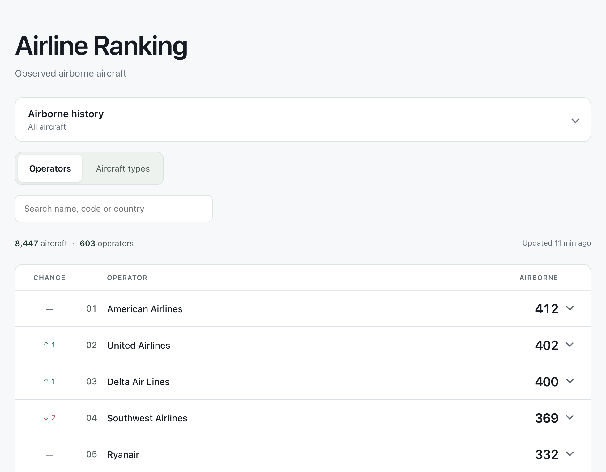
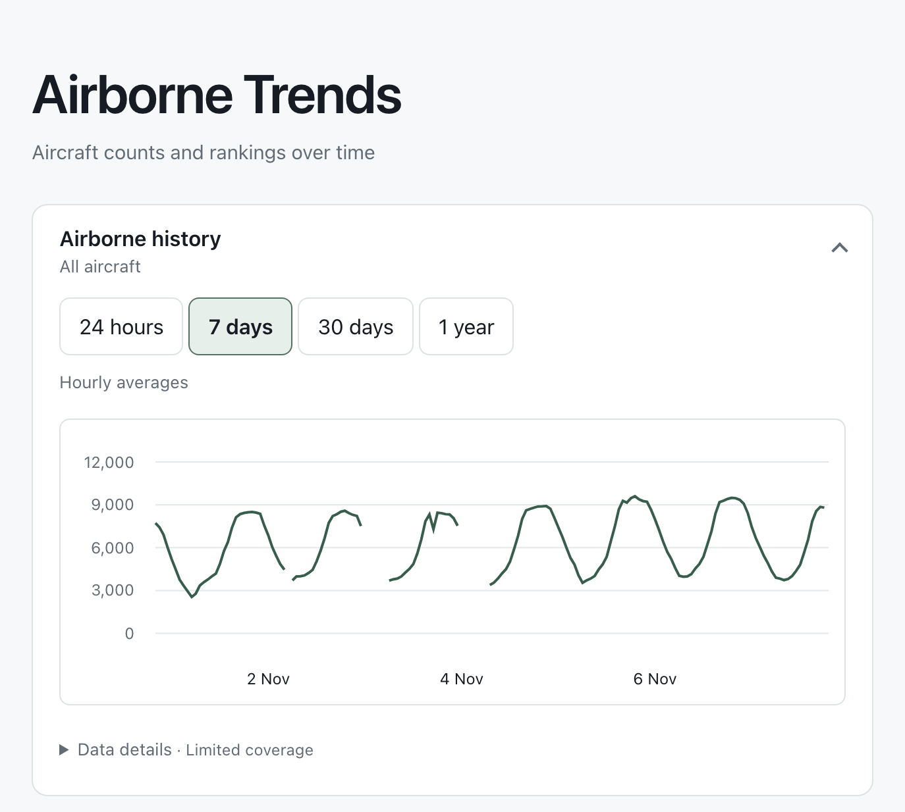
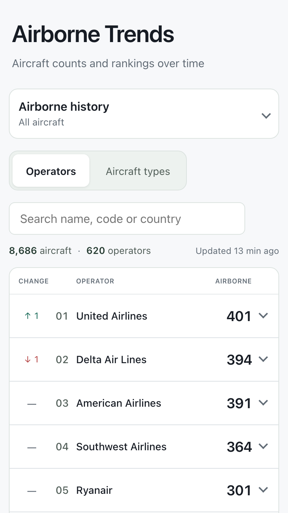
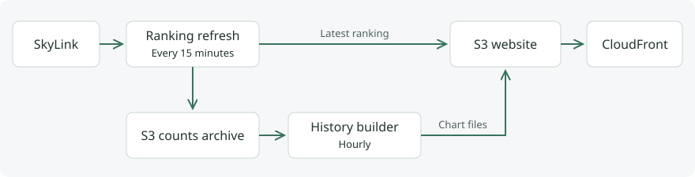

# Airborne Trends

Aircraft counts and rankings over time

Explore the latest snapshot, fleet breakdowns, aircraft locations and historical counts by operator and aircraft type.

[](https://github.com/kuosmark/airborne-trends/actions/workflows/check.yml)
[](https://github.com/kuosmark/airborne-trends/releases/latest)
[](LICENSE)

**[Try the demo](https://kuosmark.github.io/airborne-trends/)**

## Try the local demo

With Node.js 22.13+ (22.x) or 24.x, run these commands from the repository root:

```sh
npm ci
npm run demo
```

Open [localhost:4200](http://127.0.0.1:4200/). The demo generates four fictional fleets and a year of sample history locally, without credentials. Try comparing Ember Freight and Northvale Regional in their seven-day charts.



*Operator ranking from an observed snapshot. Counts change between refreshes.*



*Hourly averages across a week. Gaps mark periods with insufficient coverage.*

## Explore the rankings

- **Two perspectives:** switch between operators and ICAO aircraft types, with rank movement since the previous snapshot.
- **Fleet details:** expand a row for its breakdown and aircraft map; select a marker for callsign, type and reported altitude.
- **Aircraft filters:** combine category silhouettes and engine counts with search; matching aircraft totals update while overall ranks stay unchanged.
- **Search:** find operators by name, code or country, and aircraft types by name or ICAO code.
- **Inclusive totals:** aircraft without an identified operator or type remain visible in separate expandable sections.
- **Responsive controls:** keyboard-accessible maps, touch targets and reduced-motion support.

These are observed aircraft counts, not worldwide fleet totals. Coverage depends on SkyLink. In a live deployment, refreshes run every 15 minutes; if a refresh fails, the last successful snapshot remains visible with a delay notice. [Read the grouping and identification rules](docs/ranking.md).

### Mobile layout



## How it works



A TypeScript Lambda validates and deduplicates the observations, builds both rankings and saves a shared snapshot. Operator metadata comes from ADSBDB; bundled Mictronics references supply aircraft type names and an ICAO24 fallback.

- **Shared cached data:** visitors read through CloudFront; opening drawers and maps makes no provider requests.
- **History charts:** on-demand 24-hour observations, seven-day hourly averages, and 30-day and one-year daily averages for all aircraft and individual operators/types, prepared hourly from S3 archives.
- **Counts archive:** production can retain counts-only snapshots in private S3 storage without automatic expiration.
- **Bounded provider usage:** one scheduled poller, persisted request reservations and lookup limits protect the request budget.
- **Verified deployments:** GitHub Actions checks pull requests. Merges to `main` trigger CodePipeline and CodeBuild, which check, publish and verify the homepage and ranking response. Infrastructure changes require a separate reviewed deployment.

Built with Angular, TypeScript, Node.js and AWS CDK. [Explore the architecture](docs/architecture.md).

## Documentation

- [Development](docs/development.md) — live backend setup, checks and browser tests.
- [Ranking and data](docs/ranking.md) — filtering, grouping, movement and metadata.
- [Architecture](docs/architecture.md) — components, backend state and scheduled refreshes.
- [Deployment and operations](docs/deployment.md) — setup, automatic releases, recovery and resource cleanup.
- [Aircraft reference](backend/data/README.md) — provenance, attribution and monthly updates.
- [Contributing](CONTRIBUTING.md) — proposing changes and verification expectations.

## Licence and attribution

Project-owned code and documentation are available under the [MIT licence](LICENSE). Third-party data and assets retain their own terms:

- **Mictronics aircraft reference:** Open Data Commons Attribution License; see [provenance and retained licence](backend/data/README.md).
- **Natural Earth map outline:** [public domain](https://www.naturalearthdata.com/about/terms-of-use/).
- **SkyLink observations and ADSBDB metadata:** supplied by their respective services; the project licence does not grant rights to provider data.

Screenshots show observed snapshots captured in November 2026.
